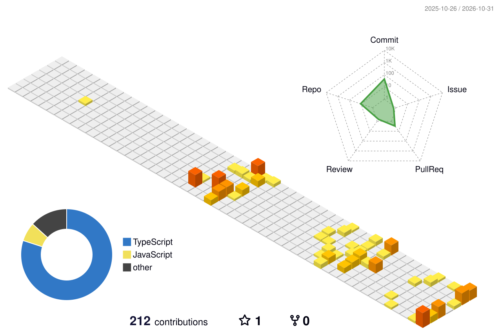

# Heya there! 👋 I'm Makiatto!

### 💻 IT Student | Fullstack Developer | UI/UX Enthusiast

Building creative projects, exploring web development, and turning ideas into interactive digital experiences.

🌱 Always learning. Always building.

---

## 💻 Programming Languages

## 🎨 Frameworks & Libraries

## 🛠️ Development Tools

## 🎨 Design Tools

## 🗄️ Databases & Backend

---

## 📊 GitHub Statistics

## 🔥 Contribution Streak

  

## 🧊 My 3D Contribution Calendar

  

## 🏆 GitHub Trophies

  

---

## 🚀 Featured Projects

### 🌙 Coming Soon!~

---

## 🌐 Connect With Me

<!-- Replace the placeholders below before enabling these buttons.

-->

---

⭐ Thanks for visiting my profile! ⭐

*Feel free to explore my repositories and projects.*

