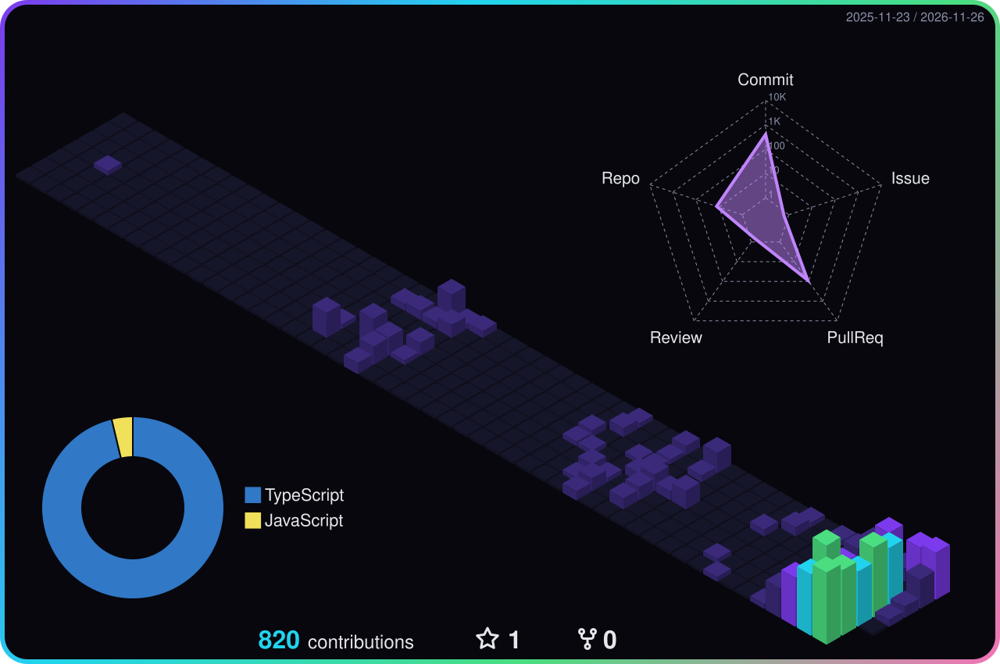

## Profile snapshot

<b>Full-stack developer · UI/UX</b>

## About

> 👩‍💻 I.T Student

*meow*

## Core toolkit

  

  

## Selected work

  

  <a href="https://github.com/sirikitmac/KalSync"><b>KalSync</b></a> · <a href="https://kalsync-seven.vercel.app">demo</a>
  &nbsp;&nbsp;|&nbsp;&nbsp;
  <a href="https://github.com/sirikitmac/sirikitvault"><b>SirikitVault</b></a> · <a href="https://sirikitvault.vercel.app">live</a>
  &nbsp;&nbsp;|&nbsp;&nbsp;
  <a href="https://github.com/sirikitmac/lgu-tracker"><b>LGU Tracker</b></a>

## Let’s connect

  

  <a href="https://sirikit-portfolio.vercel.app"><b>🌐 Portfolio</b></a> · <a href="https://github.com/sirikitmac">GitHub</a>

## Activity

  

Makiatto · Holo card style inspired by <a href="https://www.gitskins.com/readme-builder?template=holo-card">GitSkins Holo Card</a> · 3D city by <a href="https://github.com/yoshi389111/github-profile-3d-contrib">github-profile-3d-contrib</a>

