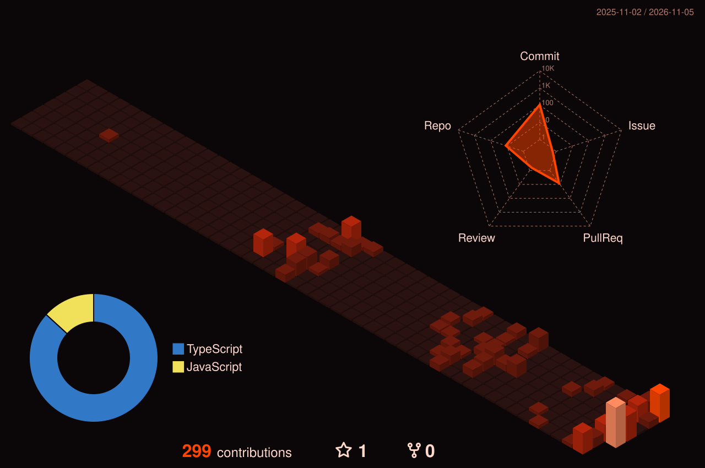

## Profile snapshot

<b>Full-stack developer · UI/UX</b>

## About

> 👩‍💻 I.T Student

*Small, useful work over vague claims.*

## Core toolkit

  

  

## Selected work

  

  <a href="https://github.com/sirikitmac/KalSync"><b>KalSync</b></a> · <a href="https://kalsync-seven.vercel.app">demo</a>
  &nbsp;&nbsp;|&nbsp;&nbsp;
  <a href="https://github.com/sirikitmac/sirikitvault"><b>SirikitVault</b></a> · <a href="https://sirikitvault.vercel.app">live</a>
  &nbsp;&nbsp;|&nbsp;&nbsp;
  <a href="https://github.com/sirikitmac/lgu-tracker"><b>LGU Tracker</b></a>

## Let’s connect

  

<a href="https://github.com/sirikitmac">GitHub</a>

## Activity

  

Makiatto · Toolkit and connect cards from <a href="https://www.gitskins.com/readme-generator">GitSkins</a> (<a href="https://www.gitskins.com/readme-generator?template=community-recruiter-ready-danv">Recruiter-ready</a> template by <a href="https://www.gitskins.com/creators/itzz-shantanu">@itzz-shantanu</a>) · 3D city by <a href="https://github.com/yoshi389111/github-profile-3d-contrib">github-profile-3d-contrib</a>

